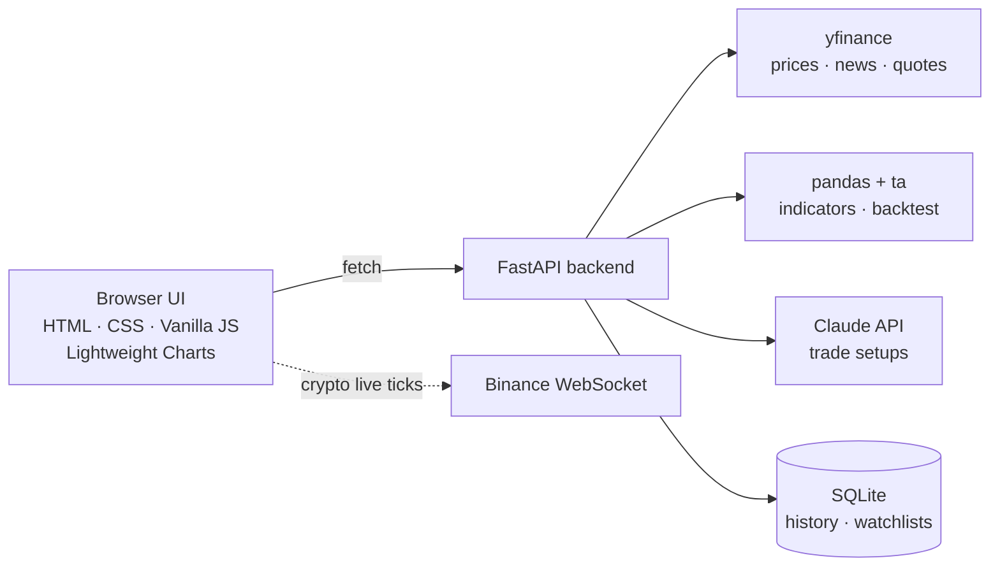

# AI Trade Idea Generator ⚡


A real-time trading terminal that turns live market data into **data-driven trade ideas**. It pulls prices with `yfinance`, computes technical indicators with `pandas` + `ta`, asks **Claude** to write validated Entry / Target / Stop setups, and lets you plot them straight onto an interactive chart. No Claude key? It falls back to rule-based setups automatically.

> Stocks · Indian indices & NSE/BSE · Crypto · Forex · Futures & commodities

---

## ✨ What You Can Do

| | Feature | Details |
|---|---|---|
| 🤖 | **AI trade ideas** | 3–5 setups per symbol with entry, target, stop, reward:risk and reasoning. Every setup is validated (levels must make sense for a long/short) and R:R is recomputed from the numbers. |
| 📍 | **Plot on chart** | One click draws Entry / Target / Stop lines on the chart. Each card shows a risk-vs-reward bar, LONG/SHORT tag and position size for *your* capital. |
| 📈 | **Live chart** | TradingView-style candles/line, volume, SMA 20/50, candlestick-pattern markers, live OHLCV readout and a bar-close countdown. |
| 🧮 | **Indicators** | RSI, MACD, Bollinger Bands, EMA 9/21 cross, ATR, relative volume, support/resistance, 0–100 technical score. |
| 🔬 | **Backtest** | 1-year RSI + SMA mean-reversion backtest with win rate, ROI, profit factor, max drawdown and an animated equity curve. |
| 👀 | **Live watchlist & tape** | Prices flash on change, daily-move bars, gainers/losers sort, add/remove with Undo, scrolling market tape. |
| 📰 | **News & order book** | Latest headlines per symbol; Level-2 depth for crypto, best bid/ask elsewhere. |
| 💾 | **Remembers everything** | Symbol, timeframe, chart type, indicators, watchlist, capital/risk and panel sizes persist in your browser. |

---

## ⌨️ Power-User Controls

Press **`Ctrl/⌘ + K`** for the command palette: jump to any ticker, switch timeframe or chart type, toggle indicators.

| Key | Action | Key | Action |
|---|---|---|---|
| `/` | Focus ticker search | `C` | Toggle candles / line |
| `1` – `6` | Timeframe 1m · 5m · 15m · 1h · 1D · 1W | `R` | Refresh AI ideas |
| `[` `]` | Previous / next watchlist symbol | `I` | Open indicators menu |
| `?` | Show all shortcuts | `Esc` | Close dialogs |

Drag the dividers to resize the side panels (double-click to reset). On phones the layout switches to bottom tabs: **Watchlist · Chart · AI Ideas**.

---

## 🏗 How It Works



1. **Fetch** OHLCV data for the symbol and timeframe (cached for 5 minutes).
2. **Compute** indicators, support/resistance and a composite technical score.
3. **Generate** setups with Claude, then **validate** them. Inconsistent or out-of-range levels are dropped.
4. **Fall back** to rule-based setups if Claude is unavailable, with a banner explaining why.
5. **Render** the chart, ideas and panels, then keep prices live via WebSocket (crypto) or 10-second polling.

---

## 🛠 Tech Stack

- **Backend:** Python 3.11+, FastAPI, Uvicorn, `yfinance`, `pandas`, `ta`, `anthropic`, SQLite
- **Frontend:** HTML5, CSS3 (dark terminal theme), Vanilla JavaScript, [Lightweight Charts](https://github.com/tradingview/lightweight-charts) via CDN, no build step

---

## 🚀 Quick Start

### 1. Backend

```bash
cd backend

python -m venv venv
venv\Scripts\activate          # Windows
source venv/bin/activate       # macOS / Linux

pip install -r requirements.txt
cp .env.example .env           # then add your ANTHROPIC_API_KEY (optional)

python main.py                 # http://127.0.0.1:8000
```

Health check: <http://127.0.0.1:8000/health>

### 2. Frontend

```bash
cd frontend
python -m http.server 3000     # http://localhost:3000
```

`frontend/config.js` already points at `http://127.0.0.1:8000`. Change `API_BASE_URL` if your backend runs elsewhere.

---

## ⚙️ Configuration

Set these in `backend/.env` (all optional):

| Variable | Default | Purpose |
|---|---|---|
| `ANTHROPIC_API_KEY` | none | Enables Claude-written setups. Without it,
