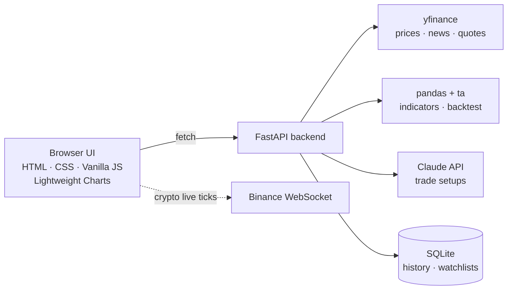

# AI Trade Idea Generator ⚡


A real-time trading terminal that turns live market data into **data-driven trade ideas**. It pulls prices with `yfinance`, computes technical indicators with `pandas` + `ta`, asks **Claude** to write validated Entry / Target / Stop setups, and lets you plot them straight onto an interactive chart. No Claude key? It falls back to rule-based setups automatically.

> Stocks · Indian indices & NSE/BSE · Crypto · Forex · Futures & commodities

**Jump to:** [Features](#-what-you-can-do) · [Shortcuts](#️-power-user-controls) · [How it works](#-how-it-works) · [Quick start](#-quick-start) · [Config](#️-configuration) · [API](#-api-reference) · [Troubleshooting](#-troubleshooting) · [Roadmap](#-roadmap)

---

## ✨ What You Can Do

| | Feature | Details |
|---|---|---|
| 🤖 | **AI trade ideas** | 3–5 setups per symbol with entry, target, stop, reward:risk and reasoning. Every setup is validated (levels must make sense for a long/short) and R:R is recomputed from the numbers. |
| 📍 | **Plot on chart** | One click draws Entry / Target / Stop lines on the chart. Each card shows a risk-vs-reward bar, LONG/SHORT tag and position size for *your* capital. |
| 📈 | **Live chart** | TradingView-style candles/line, volume, SMA 20/50, candlestick-pattern markers, live OHLCV readout and a bar-close countdown. |
| 🧮 | **Indicators** | RSI, MACD, Bollinger Bands, EMA 9/21 cross, ATR, relative volume, support/resistance, 0–100 technical score. |
| 🔬 | **Backtest** | 1-year RSI + SMA mean-reversion backtest with win rate, ROI, profit factor, max drawdown and an animated equity curve. |
| 👀 | **Live watchlist & tape** | Prices flash on change, daily-move bars, gainers/losers sort, add/remove with Undo, scrolling market tape. |
| 🔔 | **Smart alerts** | Set price above/below or RSI above/below alerts. The terminal checks them every 30 s and pops a toast the moment one fires. |
| 📰 | **News & order book** | Latest headlines per symbol; Level-2 depth for crypto, best bid/ask elsewhere. |
| 💾 | **Remembers everything** | Symbol, timeframe, chart type, indicators, watchlist, capital/risk and panel sizes persist in your browser. |

---

## ⌨️ Power-User Controls

Press **`Ctrl/⌘ + K`** for the command palette: jump to any ticker, switch timeframe or chart type, toggle indicators.

| Key | Action | Key | Action |
|---|---|---|---|
| `/` | Focus ticker search | `C` | Toggle candles / line |
| `1` – `6` | Timeframe 1m · 5m · 15m · 1h · 1D · 1W | `R` | Refresh AI ideas |
| `[` `]` | Previous / next watchlist symbol | `I` | Open indicators menu |
| `?` | Show all shortcuts | `Esc` | Close dialogs |

Drag the dividers to resize the side panels (double-click to reset). On phones the layout switches to bottom tabs: **Watchlist · Chart · AI Ideas**.

---

## 🏗 How It Works



1. **Fetch** OHLCV data for the symbol and timeframe (cached for 5 minutes).
2. **Compute** indicators, support/resistance and a composite technical score.
3. **Generate** setups with Claude, then **validate** them. Inconsistent or out-of-range levels are dropped.
4. **Fall back** to rule-based setups if Claude is unavailable, with a banner explaining why.
5. **Render** the chart, ideas and panels, then keep prices live via WebSocket (crypto) or 10-second polling.

---

## 🛠 Tech Stack

- **Backend:** Python 3.11+, FastAPI, Uvicorn, `yfinance`, `pandas`, `ta`, `anthropic`, SQLite
- **Frontend:** HTML5, CSS3 (dark terminal theme), Vanilla JavaScript, [Lightweight Charts](https://github.com/tradingview/lightweight-charts) via CDN, no build step

---

## 🚀 Quick Start

### 1. Backend

```bash
cd backend

python -m venv venv
venv\Scripts\activate          # Windows
source venv/bin/activate       # macOS / Linux

pip install -r requirements.txt
cp .env.example .env           # then add your ANTHROPIC_API_KEY (optional)

python main.py                 # http://127.0.0.1:8000
```

Health check: <http://127.0.0.1:8000/health>

### 2. Frontend

```bash
cd frontend
python -m http.server 3000     # http://localhost:3000
```

`frontend/config.js` already points at `http://127.0.0.1:8000`. Change `API_BASE_URL` if your backend runs elsewhere.

---

## ⚙️ Configuration

Set these in `backend/.env` (all optional):

| Variable | Default | Purpose |
|---|---|---|
| `ANTHROPIC_API_KEY` | none | Enables Claude-written setups. Without it, rule-based setups are used. |
| `ANTHROPIC_MODEL` | `claude-sonnet-4-6` | Claude model to use. |
| `CORS_ORIGINS` | `*` | Comma-separated frontend origins allowed to call the API. |
| `DATABASE_PATH` | `backend/trade_ideas.db` | Location of the SQLite file. |
| `LOG_LEVEL` | `INFO` | `DEBUG`, `INFO` or `WARNING`. |
| `RATE_LIMIT_PER_MIN` | `240` | Max requests per minute per client IP (`429` beyond that). |

---

## 🔌 API Reference

Interactive docs are available at `/docs` while the backend is running.

| Endpoint | Method | Description |
|---|---|---|
| `/analyze` | GET | Full analysis: indicators, chart data and AI trade ideas (`ticker`, `interval`, `period`) |
| `/live-price` | GET | Latest price and day change for one symbol |
| `/quotes` | GET | Batch quotes for the watchlist and market tape |
| `/search` | GET | Ticker and company search suggestions |
| `/news` | GET | Latest headlines for a symbol |
| `/orderbook` | GET | Order-book depth (crypto L2, otherwise best bid/ask) |
| `/backtest` | GET | 1-year strategy backtest with equity curve |
| `/history` | GET | Previously generated trade ideas |
| `/watchlist` · `/watchlist/add` · `/watchlist/remove` | GET · POST · DELETE | Saved watchlists |
| `/alerts` · `/alerts/create` | GET · POST | List and create price / RSI alerts |
| `/alerts/check` | GET | Evaluates active alerts against live data; returns and retires the ones that fired |
| `/alerts/remove` | DELETE | Delete an alert |
| `/auth/register` · `/auth/login` | POST | Basic accounts (salted PBKDF2 passwords) |
| `/health` | GET | Service and API-key status |

Supported intervals: `1m 5m 15m 30m 1h 4h 1d 1wk`. Supported periods: `1mo 3mo 6mo 1y 2y 5y`.

---

## 🧪 Tests

No network or API key needed:

```bash
cd backend
pip install -r requirements-dev.txt
pytest -q
```

Covers indicator maths, backtester metrics, AI-output validation, alert evaluation, rate limiting, caching, auth, the database and data-fetching rules.

---

## 📁 Project Structure

```
ai-trade-idea-generator/
├── backend/
│   ├── main.py            # FastAPI app and endpoints
│   ├── data_fetcher.py    # yfinance fetching, ticker resolution, search
│   ├── indicators.py      # RSI, MACD, Bollinger, ATR, support/resistance
│   ├── ai_analyzer.py     # Claude prompt, parsing, validation, caching
│   ├── trade_logic.py     # idea validation, rule-based fallback, JSON safety
│   ├── backtester.py      # strategy backtest engine
│   ├── market_extras.py   # quotes, news, order book
│   ├── auth.py · database.py · cache.py · ratelimit.py
│   └── tests/
└── frontend/
    ├── index.html · style.css · dynamic.css
    ├── app.js             # terminal logic, chart, ideas, watchlist
    ├── ui-kit.js          # toasts, command palette, resizable panels, equity chart
    └── config.js          # API base URL
```

---

## 🩺 Troubleshooting

| Problem | Fix |
|---|---|
| UI says it can't reach the API | Start the backend (`python main.py`) and confirm `API_BASE_URL` in `frontend/config.js`. Check <http://127.0.0.1:8000/health>. |
| Browser blocks requests (CORS error) | Add your frontend origin to `CORS_ORIGINS` in `backend/.env`, e.g. `http://localhost:3000`. |
| Ideas show a "rule-based" banner | No valid `ANTHROPIC_API_KEY`, no credit, or the model name is wrong. Set `ANTHROPIC_MODEL` to a model your account can use. |
| Empty chart or "feed delayed" | Yahoo Finance rate-limited or has no data for that symbol or interval. Wait a minute or try a longer timeframe. |
| `429 Too many requests` | Raise `RATE_LIMIT_PER_MIN` or reduce polling. |
| Indian stock not found | Use the Yahoo symbol, e.g. `RELIANCE.NS`, or an index like `^NSEI`. |

---

## 🗺 Roadmap

- [ ] Session tokens so watchlists and alerts are tied to a logged-in user
- [ ] Background alert worker with browser / email notifications
- [ ] Exchange-holiday aware market-session pills
- [ ] More backtest strategies and parameter controls

---

## ⚠️ Known Limitations

- Watchlist and alert endpoints take a client-supplied `user_id` and there are no session tokens yet, so they suit single-user use.
- Alerts are evaluated while the terminal is open (or when `/alerts/check` is called); there is no background worker or push/email delivery yet.
- Rate limiting is in-memory and per process, so it suits a single server instance.
- Market-session pills use regular trading hours only and don't know about exchange holidays.
- Data comes from Yahoo Finance via `yfinance`, so it can be delayed and is occasionally rate-limited.

---

## ⚖️ Disclaimer

*For educational purposes only. Not financial advice. Not a SEBI-registered recommendation.*
